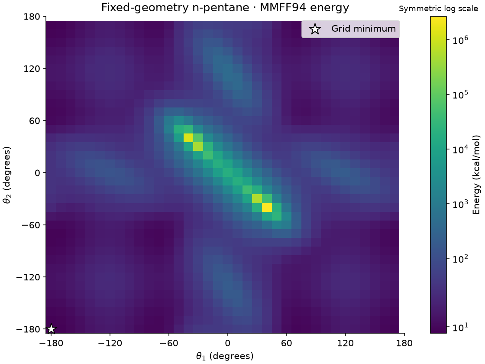
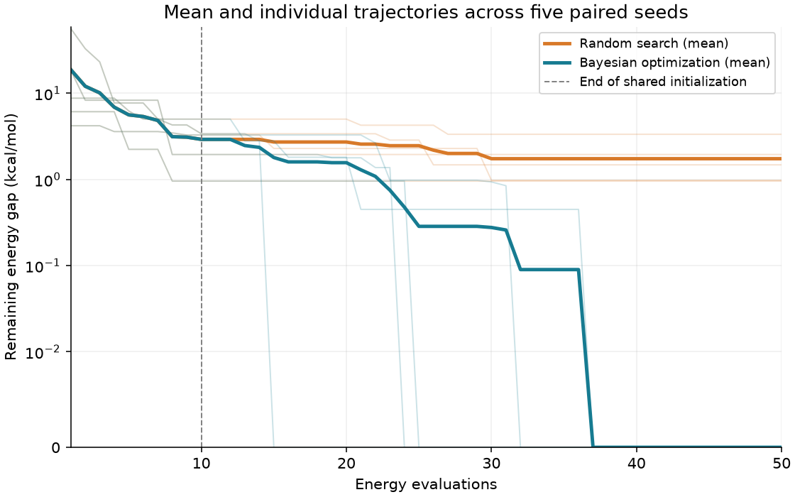
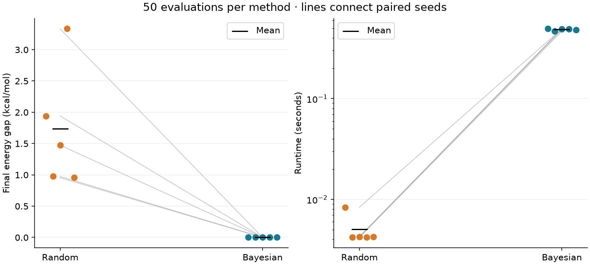

# Sample-Efficient Molecular Conformation Search with Bayesian Optimization

## Observed result

Bayesian optimization had a **lower mean final energy gap** in this run. It won 5 of 5 paired seeds, with 0 ties (tolerance 1e-8 kcal/mol). Five seeds on one small molecule provide a demonstration, not a general performance claim.

The independently evaluated grid minimum is **7.890761 kcal/mol** at angles **[-180.0, -180.0] degrees**.

| Seed | Method | Best energy (kcal/mol) | Final gap (kcal/mol) | Runtime (s) |
| --- | --- | ---: | ---: | ---: |
| 0 | Random search | 9.831265 | 1.940504 | 0.0083 |
| 0 | Bayesian optimization | 7.890761 | 0.000000 | 0.4939 |
| 1 | Random search | 8.865006 | 0.974245 | 0.0042 |
| 1 | Bayesian optimization | 7.890761 | 0.000000 | 0.4675 |
| 2 | Random search | 9.362946 | 1.472186 | 0.0043 |
| 2 | Bayesian optimization | 7.890761 | 0.000000 | 0.4916 |
| 3 | Random search | 11.223212 | 3.332451 | 0.0042 |
| 3 | Bayesian optimization | 7.890761 | 0.000000 | 0.4932 |
| 4 | Random search | 8.844282 | 0.953521 | 0.0042 |
| 4 | Bayesian optimization | 7.890761 | 0.000000 | 0.4838 |

Mean final gaps: random **1.734581**, Bayesian **0.000000 kcal/mol**.

## Figures

The heatmap uses a symmetric log color scale (linear below 20 kcal/mol) to show low-energy structure alongside steric clashes. The gap plot uses a symmetric log scale with a linear region below 0.01 kcal/mol, so zero remains visible. Thin lines are individual seeds; thick lines are means. The comparison connects paired seeds and marks means with black horizontal ticks.

## Protocol and interpretation

- Explicit-hydrogen n-pentane; one ETKDGv3 starting geometry with embedding seed 2026. No force-field relaxation, including before the searches. Other internal coordinates stay fixed.
- MMFF94 with all nonbonded pairs included (100 Å threshold); energies are in kcal/mol.
- Two absolute carbon torsions, on the 36 × 36 grid from −180° through 170° at 10° spacing.
- Seeds 0–4; each method makes 50 actual oracle calls, including the same 10 initial points per seed. Subsequent queries never repeat within a run.
- Random search samples unseen grid points uniformly. BO uses sine/cosine features, a normalized-output Gaussian process with a constant × Matérn-5/2 kernel, one shared length scale, and expected improvement for minimization (no exploration offset). Kernel parameters are fitted by marginal likelihood with two additional optimizer restarts at each query; bounds and numerical jitter are fixed before the experiment.
- All searches complete before a separate oracle evaluates the 1,296-point reference. The reference table and minimum are used only for scoring and plotting.
- Runtime includes initial queries, geometry construction, force-field energy calls, and search overhead. It excludes starting-geometry embedding, exhaustive scoring, plotting, and file output. Methods run sequentially with one BLAS thread; timings depend on hardware.
- MMFF energies are approximate and the fixed embedded geometry affects this landscape. This is a molecular-modeling optimization benchmark, not a drug-discovery result.

GP optimizer convergence/bound warnings recorded: 1. Their per-run counts are saved in summary.csv; fitted parameters can reach the predefined bounds.

## Explain it tomorrow

“I compared uncertainty-guided Bayesian optimization with random search on a molecular energy landscape. Each method had just 50 energy evaluations. I held the geometry fixed except for two torsions, and used an exhaustive grid only to measure how far each search remained from the best possible grid energy.”

Implementation references: [RDKit torsion transforms](https://www.rdkit.org/docs/source/rdkit.Chem.rdMolTransforms.html), [RDKit force-field energy API](https://www.rdkit.org/docs/source/rdkit.ForceField.rdForceField.html).
